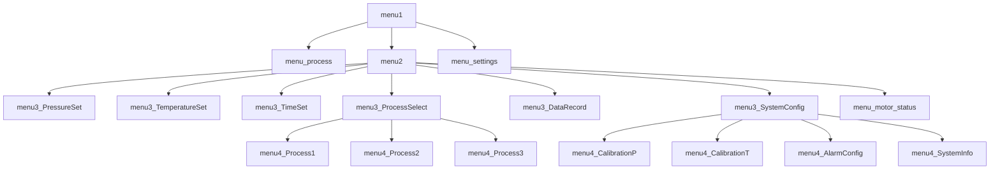

# 六面顶菜单系统说明文档

## 1. 系统概述

本菜单系统用于实现碳转石墨过程的可视化控制，采用分层结构设计，包含多级菜单界面。系统通过OLED显示屏展示工艺参数和状态，并通过按键进行交互控制。

## 2. 菜单层级结构

### 2.1 一级菜单 (menu1)
- **工艺过程** → `menu_process()`
- **参数设置** → `menu2()`
- **系统设置** → `menu_settings()`

### 2.2 二级菜单 (menu2)
- **压力设置** → `menu3_PressureSet()`
- **温度设置** → `menu3_TemperatureSet()`
- **时间设置** → `menu3_TimeSet()`
- **工艺选择** → `menu3_ProcessSelect()`
- **数据记录** → `menu3_DataRecord()`
- **系统配置** → `menu3_SystemConfig()`
- **电机状态** → `menu_motor_status()`

### 2.3 三级菜单

#### 2.3.1 工艺选择菜单 (menu3_ProcessSelect)
- **工艺1** → `menu4_Process1()`
- **工艺2** → `menu4_Process2()`
- **工艺3** → `menu4_Process3()`

#### 2.3.2 系统配置菜单 (menu3_SystemConfig)
- **压力校准** → `menu4_CalibrationP()`
- **温度校准** → `menu4_CalibrationT()`
- **报警配置** → `menu4_AlarmConfig()`
- **系统信息** → `menu4_SystemInfo()`

## 3. 功能模块说明

### 3.1 显示控制模块

#### 3.1.1 显示更新标志控制
- `set_display_update_flag()`：设置更新标志
- `clear_display_update_flag()`：清除更新标志
- `is_display_update_needed()`：检查是否需要更新

#### 3.1.2 显示更新优化
- 使用 `display_changed` 标志控制显示更新
- 仅在以下情况更新显示：
  - 菜单初始化时
  - 按键操作导致选择项改变时
  - 数值发生变化时
  - 界面切换时
- 优化效果：
  - 避免重复更新相同内容
  - 优化GPIO通信开销
  - 提高系统响应速度
  - 降低功耗
  - 延长OLED显示屏使用寿命

### 3.2 系统状态管理
- `update_system_state()`：更新系统状态
  - 压力监测
  - 温度监测
  - 警报处理
  - 显示更新控制

### 3.3 参数设置功能
- **压力设置**：支持整数/小数调节
- **温度设置**：支持大幅/微调
- **时间设置**：支持小时/分钟设置
- **电机控制**：支持三轴进给量和速度调节

### 3.4 显示效果
- 3D模型显示
- 粒子效果动画
- 状态栏显示
- 警告效果显示

## 4. 按键操作说明

| 按键 | 功能 |
|------|------|
| 按键1 | 上移/增加 |
| 按键2 | 下移/减少 |
| 按键3 | 确认/切换 |
| 按键4 | 返回 |
| 按键5 | 确认（部分界面） |

## 5. 系统参数定义

### 5.1 警报级别
| 级别 | 说明 |
|------|------|
| `ALERT_NONE` | 无警报 |
| `ALERT_WARNING` | 警告 |
| `ALERT_CRITICAL` | 危险 |

### 5.2 工艺状态
| 状态 | 说明 |
|------|------|
| `PROCESS_IDLE` | 待机 |
| `PROCESS_HEATING` | 加热 |
| `PROCESS_PRESSING` | 加压 |
| `PROCESS_TRANSFORM` | 转化 |
| `PROCESS_COOLING` | 冷却 |
| `PROCESS_ERROR` | 错误 |

### 5.3 显示模式
| 模式 | 说明 |
|------|------|
| `DISPLAY_MODE_NORMAL` | 正常模式 |
| `DISPLAY_MODE_NIGHT` | 夜间模式 |
| `DISPLAY_MODE_DEMO` | 演示模式 |

## 6. 调用关系图

## 7. 显示更新优化说明

### 7.1 优化原理
- 引入 `display_changed` 标志控制显示更新
- 避免重复更新相同内容
- 减少不必要的GPIO通信

### 7.2 更新触发条件

#### 7.2.1 菜单初始化时
- 进入新菜单界面
- 系统启动时

#### 7.2.2 用户操作时
- 按键选择改变
- 数值调整
- 模式切换

#### 7.2.3 系统状态变化时
- 压力值变化
- 温度值变化
- 警报状态变化

### 7.3 优化效果

#### 7.3.1 性能提升
- 减少GPIO通信次数
- 提高系统响应速度
- 降低CPU负载

#### 7.3.2 功耗降低
- 减少OLED刷新频率
- 降低系统整体功耗

#### 7.3.3 硬件保护
- 延长OLED显示屏寿命
- 减少GPIO磨损

### 7.4 注意事项

#### 7.4.1 实时监控界面
- 工艺过程监控界面需要实时更新
- 保持原有的更新逻辑

#### 7.4.2 状态显示
- 确保重要状态变化及时显示
- 保持用户界面响应性

#### 7.4.3 调试维护
- 可通过标志位追踪显示更新
- 便于问题定位和优化 